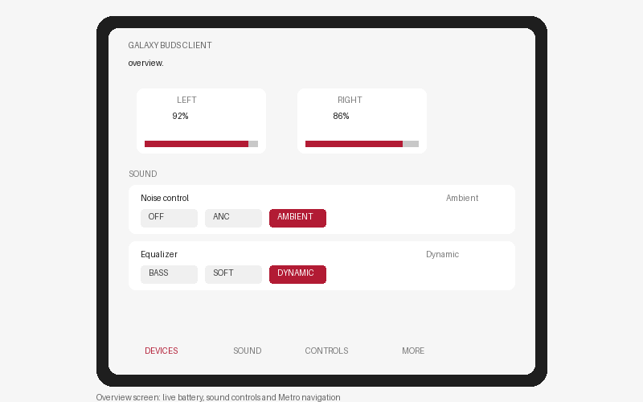

<p align="center">
  
</p>

<h1 align="center">Galaxy Buds Client for Windows Phone</h1>

<p align="center">
  <strong>Unofficial Galaxy Buds manager for Windows Phone 8.1 Silverlight.</strong><br>
  Connect your Galaxy Buds over Bluetooth and control sound, touch, and device settings from your Windows Phone.
</p>

<p align="center">
  <a href="#features">Features</a> ·
  <a href="#install">Install</a> ·
  <a href="#build">Build</a> ·
  <a href="#usage">Usage</a> ·
  <a href="#credits">Credits</a> ·
  <a href="#license">License</a>
</p>

<p align="center">
  <a href="LICENSE"></a>
  
  
</p>

<p align="center">
  
</p>

Galaxy Buds Client connects to paired Samsung Galaxy Buds over Bluetooth RFCOMM and lets you read battery status, adjust the equalizer, control ambient sound, lock the touchpad, and find misplaced earbuds. It runs on Windows Phone 8.1 Silverlight and is free software.

**Good for:** reading live battery, changing equalizer presets, locking the touchpad, finding earbuds nearby, and managing paired Buds from a Windows Phone.

**Not for:** firmware updates (disabled due to safety complexity), desktop-only features like system tray integration or spatial audio routing, or models not listed below.

## Features

| Feature | Status |
|---|---|
| Device discovery and connection | Working |
| Live left/right battery status | Working |
| Equalizer presets (5 bands) | Working |
| Ambient sound on/off | Working |
| Ambient volume control | Working |
| Touchpad lock | Working |
| Find my earbuds | Working |
| Factory reset (with confirmation) | Working |
| Case battery | Supported on Buds+ and newer |
| Custom equalizer | Supported on Buds2 Pro and newer |
| ANC / Noise control | Supported on Buds Live and newer |
| Firmware update | Not enabled on WP |

## Supported models

Galaxy Buds (2019), Galaxy Buds+, Galaxy Buds Live, Galaxy Buds Pro, Galaxy Buds2, Galaxy Buds2 Pro, Galaxy Buds FE, Galaxy Buds Core, Galaxy Buds3, Galaxy Buds3 Pro, Galaxy Buds3 FE, Galaxy Buds4, Galaxy Buds4 Pro.

Feature availability varies by model and firmware revision. See [docs/FEATURE-PARITY.md](docs/FEATURE-PARITY.md) for the full matrix.

## Install

Build the XAP from source (see [Build](#build)) and deploy to a Windows Phone 8.1 device using the Windows Phone Application Deployment tool or `AppDeployCmd`.

**Pair your Galaxy Buds first** in the phone's Bluetooth settings, then open the app and tap "Scan for earbuds". The app uses the system Bluetooth pairing; it does not handle pairing itself.

## Build

**Prerequisites:** Visual Studio 2013 or MSBuild 14 with the Windows Phone 8.1 SDK.

```powershell
MSBuild "Galaxy Buds App.sln" /p:Configuration=Release
```

The output XAP is written to `Galaxy Buds App\Bin\Release\Galaxy_Buds_App_Release_AnyCPU.xap`.

Run the protocol and model tests:

```powershell
C:\Windows\Microsoft.NET\Framework\v4.0.30319\csc.exe /out:tests.exe tests\GalaxyBuds.Protocol.Tests\ProtocolTests.cs "Galaxy Buds App\Protocol\SppPacket.cs"
tests.exe
```

## Usage

1. Pair your Galaxy Buds in phone Bluetooth settings.
2. Open Galaxy Buds Client.
3. Tap **Scan for earbuds** and select your device.
4. Tap **Connect**. Live battery readings appear in the overview.
5. Use the Sound, Controls, and Device tools sections to manage your earbuds.

The app follows the phone's language: Italian on Italian devices, English everywhere else.

## Privacy

The app does not send any data to external services. Bluetooth communication is local only. No analytics, no tracking, no network requests.

## Credits

This project is based on [GalaxyBudsClient](https://github.com/timschneeb/GalaxyBudsClient) by Tim Schneeberger (`@timschneeb`), which documents the proprietary Samsung Galaxy Buds RFCOMM protocol through reverse engineering. Protocol notes and implementation are used under GPL-3.0. See [docs/PROTOCOL-CREDITS.md](docs/PROTOCOL-CREDITS.md) for full attribution.

This Windows Phone port is independent and unofficial. It is not affiliated with Samsung or the upstream author.

## License

GPL-3.0. See [LICENSE](LICENSE).

Galaxy Buds and Samsung are trademarks of Samsung Electronics Co., Ltd.
